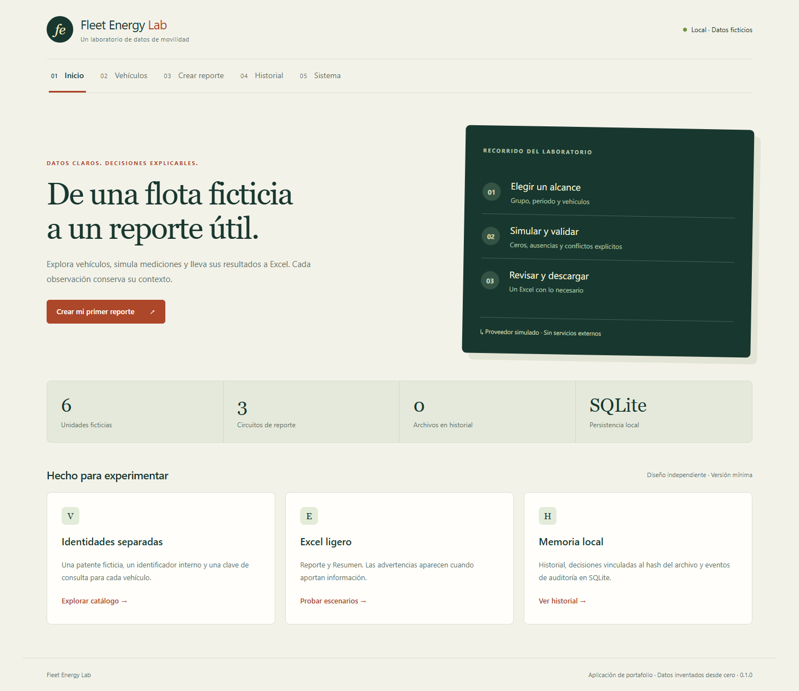
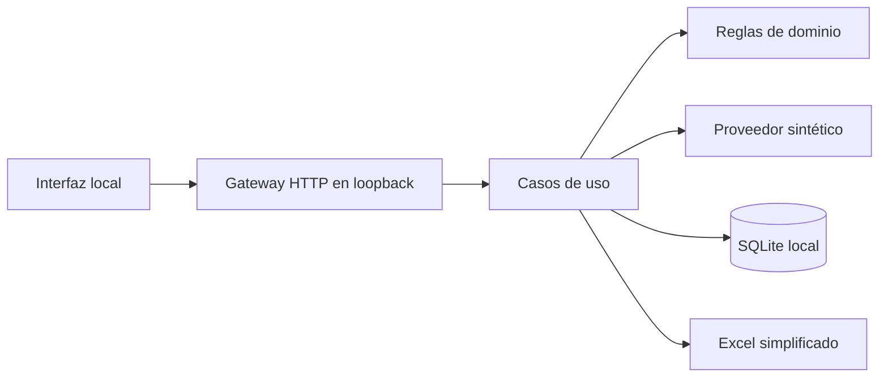
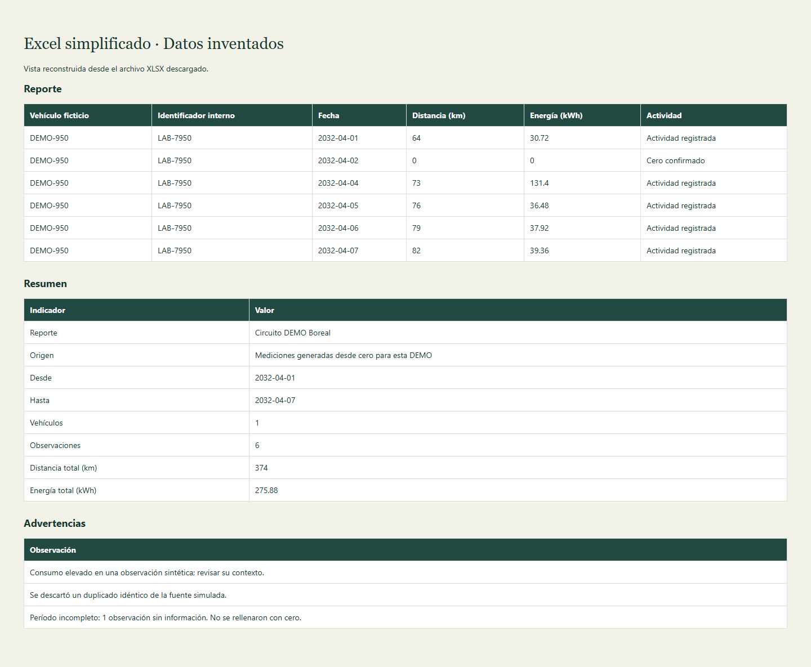

# Fleet Energy Lab

Aplicación web local en Python para explorar un catálogo ficticio de vehículos,
validar mediciones simuladas y producir reportes Excel claros y verificables.

**Implementación original e independiente. Datos 100 % sintéticos. Versión mínima
para portafolio; no se declara uso productivo.**



## Problema y propuesta

Un reporte de flota necesita distinguir identidades, períodos, ausencia de datos y
actividad cero. Este laboratorio hace visible ese recorrido: elegir un alcance,
extraer mediciones inventadas, validar, transformar y descargar un Excel. Mantiene
la evidencia técnica dentro de la aplicación para simplificar el archivo cotidiano.

## Funcionalidades

- Inicio con indicadores de catálogo e historial.
- Vehículos ficticios con patente, identificador interno y clave de consulta independientes.
- Alta, edición, búsqueda, desactivación confirmada y reactivación.
- Un grupo con tres circuitos de reporte; asociaciones explícitas y vigencias.
- Vista previa con datos regulares, ceros confirmados, ausencias, advertencias,
  duplicados idénticos y conflictos que impiden generar resultados.
- Reportes Excel con fechas/números nativos, tablas, filtros y formato legible.
- Historial con instantáneas, SHA-256 y decisiones de revisión DEMO.
- Auditoría local, exportación JSON, importación con vista previa y respaldo/restauración.
- Cinco pantallas adaptables a escritorio y teléfono.

## Arquitectura y tecnologías

Backend: Python 3.13, servidor HTTP de biblioteca estándar y SQLite. Exportación:
openpyxl. Frontend: HTML, CSS y JavaScript sin framework, fuentes remotas ni CDN.
Playwright proporciona una ventana aislada opcional y pruebas de navegador.



[Arquitectura, modelo y seguridad](docs/ARQUITECTURA.md) ·
[Contrato de fuentes simuladas](docs/FUENTES.md) ·
[Validación de esta versión](docs/VALIDACION.md)

## Instalación en Windows

Requisitos de referencia: Windows de 64 bits y Python **3.13 de 64 bits**. La
validación de esta versión utiliza Python 3.13.14. No hace falta Microsoft Excel
para generar, descargar y validar el XLSX con openpyxl.

En PowerShell, desde esta carpeta:

```powershell
py -3.13 -m venv .venv
.\.venv\Scripts\python.exe -m pip install -r requirements.txt
.\.venv\Scripts\python.exe -m pip check
.\.venv\Scripts\python.exe -m playwright install chromium
```

Las versiones están fijadas. No se instalan paquetes globalmente. La instalación
de paquetes y del navegador requiere acceso a sus repositorios; la aplicación en
funcionamiento utiliza solamente loopback. No necesita credenciales ni archivo .env.
No se requiere modificar ExecutionPolicy ni ejecutar PowerShell como administrador.

## Ejecución

Hacer doble clic en **Abrir_Demo.cmd**. El lanzador utiliza el Python de `.venv`,
abre una ventana Chromium nueva y cierra su servidor al cerrar esa ventana.
No reutiliza una sesión personal del navegador. Si falta Chromium, seguir el comando
de instalación anterior; el lanzador no instala ni actualiza paquetes automáticamente.

También puede iniciarse solo el servidor:

```powershell
.\.venv\Scripts\python.exe -E -B -m fleet_lab.web
```

La consola muestra la URL local, con un puerto disponible elegido automáticamente.
Abrirla y usar Ctrl+C para terminar. Un puerto específico puede solicitarse con
`--port 8765`; si está ocupado se informa el fallo, sin abrir otro servidor a escondidas.
La carpeta por defecto para datos es `.local-state`, junto al proyecto. `--data`
permite elegir otra carpeta propia y vacía. No usar carpetas con información real.

## Funcionamiento sin internet

Una vez instaladas las dependencias y Chromium, las cinco pantallas, SQLite y
la generación de Excel funcionan sin internet. No hay fuentes remotas, descargas
automáticas al iniciar, servicios alojados ni sincronización. La instalación inicial
es un paso separado; no se repitió durante la comprobación offline.

Las pruebas bloquean conexiones no locales del backend. El recorrido completo
utiliza un proxy de loopback no operativo, con excepción para el servidor local,
y bloquea solicitudes ajenas a ese origen. No se cambia la configuración de red
ni las políticas del equipo. Los recursos HTML, CSS, JavaScript y las fuentes
simuladas ya están dentro de este directorio.

## Generar el primer reporte

1. Ir a **Crear reporte**.
2. Mantener el grupo y el circuito Boreal, y el período ficticio **2032-04-01 a 2032-04-07**.
3. Seleccionar una unidad activa y vigente; por ejemplo DEMO-901.
4. El escenario inicial es **Actividad regular**: produce un Excel de dos hojas.
   Elegir **Laboratorio mixto** solo si se quieren explorar ausencias, un cero
   confirmado, consumo elevado y un duplicado con sus advertencias.
5. Revisar la vista previa y pulsar **Generar Excel** y **Descargar Excel**.
6. Consultar **Historial** y registrar una decisión DEMO vinculada al hash exacto.

Un alta de vehículo no lo incorpora automáticamente a reportes. Guardar una
asociación en Vehículos, con vigencia que cubra todo el período solicitado.

## Estructura del Excel

| Hoja | Contenido |
|---|---|
| Reporte | Vehículo ficticio, identificador interno, fecha, km, kWh y actividad |
| Resumen | Alcance, origen sintético y totales |
| Advertencias | Solo aparece si hay observaciones |

La opción **Añadir una hoja de detalle técnico** está desactivada por defecto.
Auditoría, huellas e instantáneas se conservan en SQLite. Una información ausente
no se convierte en cero. Un conflicto bloquea la generación; un duplicado idéntico
se descarta con advertencia. No se añaden macros ni conexiones a fuentes externas.



La imagen anterior utiliza el escenario mixto, elegido expresamente, y reconstruye
las celdas del XLSX para revisión visual; no se presenta como una captura de
Microsoft Excel.

## Capturas revisadas

Todas las imágenes se generaron dentro de esta implementación, con datos ficticios.

| Vista | Archivo |
|---|---|
| Inicio | [inicio.png](screenshots/inicio.png) |
| Vehículos | [vehiculos.png](screenshots/vehiculos.png) |
| Crear reporte, escenario mixto elegido expresamente | [crear-reporte.png](screenshots/crear-reporte.png) |
| Grupo y vigencias dentro del catálogo | [grupos.png](screenshots/grupos.png) |
| Historial | [historial.png](screenshots/historial.png) |
| Estado y auditoría local | [sistema.png](screenshots/sistema.png) |
| Celdas del Excel con advertencias sintéticas | [excel-simplificado.png](screenshots/excel-simplificado.png) |

La revisión visual no encontró datos reales, cuentas, rutas personales, notificaciones
ni referencias a servicios empresariales. La tabla del Excel es una visualización de
su contenido; su revisión de estructura y tipos se realizó con openpyxl.

## Historial, catálogo y recuperación

Las ediciones del catálogo no reescriben instantáneas del historial. Antes de una
importación, la aplicación crea un respaldo JSON del catálogo anterior. La vista
previa valida sin escribir. La restauración exige nombre y SHA-256 del respaldo,
reemplaza únicamente el catálogo y conserva reportes y eventos de auditoría.

El botón de restaurar utiliza el respaldo creado durante la sesión de interfaz.
Los archivos de respaldo permanecen en `.local-state/backups`; el API documentado
acepta su nombre y hash tras un reinicio. Un respaldo de catálogo **no es** un respaldo
de toda la aplicación. Para trasladar el historial completo, cerrar la aplicación
y copiar la carpeta técnica local con sus exportaciones, solo si contiene datos ficticios.

## Pruebas nuevas

```powershell
.\.venv\Scripts\python.exe -E -B -m unittest discover -s tests -p "test_*.py" -v
.\.venv\Scripts\python.exe -E -B tests\browser_walkthrough.py
```

Las pruebas usan catálogos, períodos y mediciones inventados en directorios temporales.
El recorrido genera siete capturas propias y dos XLSX en `.qa/review`: uno básico
y otro con advertencias. Reabre ambos con openpyxl, verifica sus hojas/tipos y
bloquea toda solicitud a otros orígenes.
Los resultados de esta implementación se detallan en [VALIDACION.md](docs/VALIDACION.md).
No se reutilizan cifras, pruebas ni resultados de otro proyecto.

## Seguridad y privacidad

- Servidor enlazado exclusivamente a `127.0.0.1`, con comprobación de Host y Origin.
- Escrituras mediante JSON, con tamaño limitado; no hay endpoints para abrir rutas arbitrarias.
- Consultas SQL parametrizadas y relaciones con claves foráneas.
- Catálogo estricto con patentes exclusivamente `DEMO-` y campos separados.
- Neutralización de cadenas que podrían interpretarse como fórmulas en Excel.
- Descargas y decisiones verifican la huella del archivo.
- Interfaz sin HTML procedente de datos y con política de contenido del mismo origen.
- Sin inicio de sesión, cookies, conectores de red o perfiles autenticados.
- Datos locales, exportaciones, entornos, registros y resultados de QA excluidos de Git.

Es un laboratorio de usuario único: no ofrece autenticación corporativa, cifrado de
la base, permisos por rol, aislamiento del sistema operativo ni hosting público.
Un proceso con permisos sobre la carpeta local puede modificar sus archivos.

## Estructura

```text
fleet_lab/             Dominio, proveedor, SQLite, casos de uso, Excel y gateway HTTP
fleet_lab/web_assets/  HTML, CSS y JavaScript originales
datos_demo/            Semilla inventada y versionable
configuraciones/example/ Ejemplo informativo sin secretos
tests/                 Unitarias, integración HTTP y recorrido de navegador nuevos
docs/                  Arquitectura, fuentes, resultados y propuesta de commit
screenshots/           Solo capturas de esta DEMO
```

## Próximas mejoras y aprendizajes

Posibles mejoras: comparar reportes en la interfaz, elegir respaldos de sesiones
anteriores y ampliar el esquema con migraciones incrementales verificadas.
El alcance actual no incluye integración con sistemas reales.

El desarrollo ejercita separación de dominio y transporte, diseño de un contrato
de proveedor, integridad de archivos, transacciones SQLite, recuperación y pruebas
de casos incompletos. El diseño visual y el código se escribieron específicamente
para este laboratorio; no se copiaron estilos, selectores o recursos de otra aplicación.

## Archivos para revisión

La lista completa de los **34 archivos candidatos** y el comando propuesto del
primer commit están en [PRIMER_COMMIT.md](docs/PRIMER_COMMIT.md). El árbol y el
estado Git del cierre se conservan en [ENTREGA.md](docs/ENTREGA.md).
La base local, reportes, dependencias y evidencia de QA están ignorados y no forman
parte de esa lista. `datos_demo/seed.json`, los ejemplos y las capturas sí son visibles.
No se ha realizado staging, commit, configuración de remotos ni publicación.

## Autoría, licencia y procedencia

**Autora: Rosio Ametller.**

## Licencia

Este proyecto se distribuye bajo la Licencia MIT. Consulta el archivo
[LICENSE](LICENSE) para más información.

Proyecto de portafolio sobre una necesidad general de reportes de movilidad.
Esta implementación utiliza exclusivamente vehículos, configuraciones y mediciones
inventados desde cero. No contiene información operacional ni archivos de terceros
procedentes de una organización. No se copiaron código, pruebas, documentación,
diseños, configuraciones, imágenes ni historial de otra implementación.
