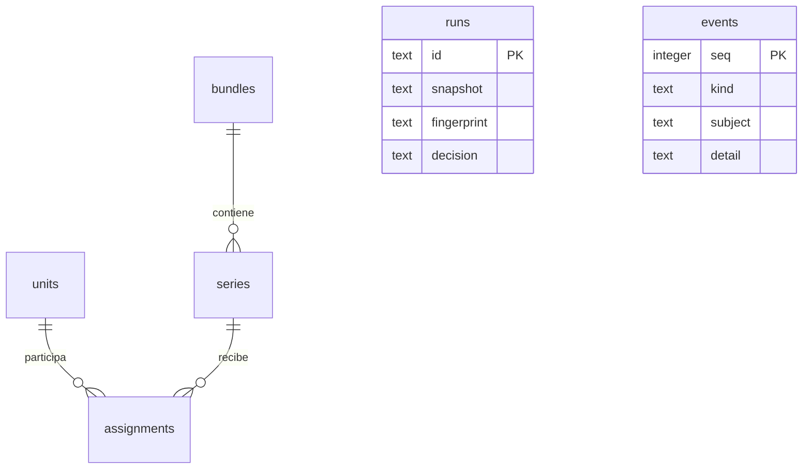

# Arquitectura del laboratorio

## Componentes

`ConsoleGateway` traduce HTTP a operaciones JSON, sin lógica de mediciones.
`FleetWorkspace` coordina una fuente, reglas de dominio, escritura XLSX e historial.
`LabDatabase` abre una conexión SQLite por transacción y serializa operaciones con
un RLock del proceso. La exportación utiliza un archivo temporal propio y renombrado
atómico antes de registrar la ejecución. Si falla el registro, se retira solo ese
archivo nuevo para no dejar un reporte no registrado.

Los recursos web se sirven por una lista cerrada de tres rutas. El frontend utiliza
DOM y textContent para mostrar datos. No hay scripts o estilos de terceros en red.

## SQLite: esquema 1

- `units`: patente ficticia única, identificador interno y clave de consulta independientes.
- `assignments`: relación explícita con vigencia inclusiva que cubre todo el período.
- `runs`: instantánea de identidades/configuración, observaciones y hash del archivo.
- `events`: registro acumulativo de eventos, incluido respaldo y restauración.
- `lab_meta`: marca de inicialización; una base ya inicializada no vuelve a sembrarse.

`PRAGMA user_version=1` identifica la versión inicial. Una versión futura desconocida
se rechaza; no se hace downgrade silencioso. No se afirma una migración desde otros
productos o esquemas. Futuras versiones deberán incorporar migraciones nuevas.

## Generación de Excel

El proveedor genera observaciones por vehículo y fecha. Las reglas verifican
alcance, tipos, números finitos no negativos, duplicados y confirmación de ceros.
Conflictos y datos inválidos impiden generar; las ausencias producen advertencias.
La vista previa no guarda un reporte. La generación reevalúa los datos dentro del
bloque de coordinación y conserva una instantánea independiente del catálogo mutable.

El archivo habitual contiene Reporte, Resumen y Advertencias solo si corresponde.
El detalle técnico opcional está apagado al inicio. Fechas y métricas se escriben
con tipos nativos; tablas y filtros se agregan sobre rangos no superpuestos.

## API y controles

| Acción | Ruta |
|---|---|
| Catálogo, candidatos vigentes, historial, auditoría, estado | GET /api/catalog, /api/available, /api/history, /api/audit, /api/state |
| Exportar catálogo | GET /api/catalog-export |
| Guardar vehículo/asociación | POST /api/unit, /api/assignment |
| Vista previa/generación | POST /api/preview, /api/generate |
| Decisión DEMO por ID y SHA-256 | POST /api/decision |
| Vista previa/importación | POST /api/import-preview, /api/import |
| Respaldo/restauración con nombre y SHA-256 | POST /api/backup, /api/restore |
| Archivo verificado | GET /download/{id} |

Toda escritura requiere JSON y Origin igual al servidor local. Host debe coincidir
con 127.0.0.1 y su puerto. No se ofrece CORS ni autenticación; este diseño presupone
un solo usuario en un equipo propio. No es un servidor de internet ni una barrera
contra procesos que tengan los mismos permisos locales.

La ventana opcional usa un contexto Chromium nuevo, con solicitudes restringidas al
origen de la aplicación. El modo de servidor por consola no abre navegador. Al
cerrar la ventana propia o usar Ctrl+C se cierra el servidor; no se detienen procesos ajenos.

## Recuperación y portabilidad

Un respaldo JSON valida formato, identidades, claves foráneas y vigencias. Se verifica
su hash antes de restaurar. La importación y el respaldo previo se serializan para
capturar el estado anterior a la sustitución; el historial y los eventos se conservan.
Los nombres de respaldo aceptan solo un identificador hexadecimal y extensión JSON.

Instalar en un entorno virtual nuevo, sin trasladar .venv. El único dato inicial es
la semilla sintética versionada. Por defecto, todos los resultados se guardan en
.local-state relativa al proyecto. No se incluyen rutas personales en el código,
el estado visible ni los archivos de Excel. Usar un destino nuevo al probar otra instalación.

## Archivos que se distribuyen

La semilla JSON y el ejemplo de configuración son fuentes visibles en Git. SQLite,
exportaciones XLSX, respaldos de ejecución, perfiles, dependencias instaladas y
resultados de QA quedan fuera de los candidatos. Los respaldos JSON del catálogo
son una herramienta local de recuperación; no sustituyen un respaldo de todo el
historial y sus archivos. La lista exacta de la entrega está en PRIMER_COMMIT.md.
